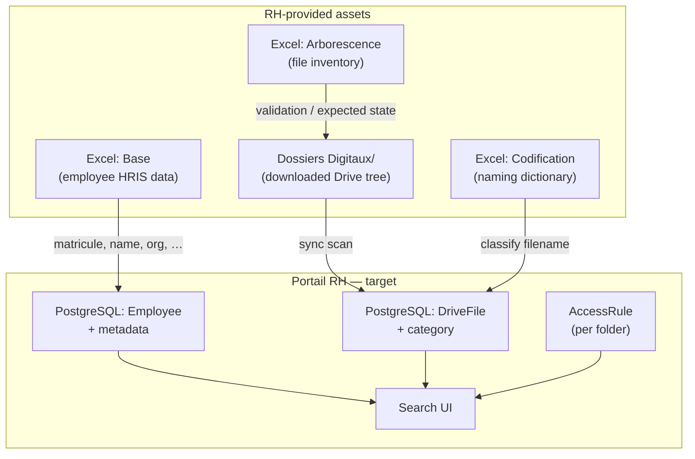

# Overview — RH exercise data model

## Why this exercise exists

RH provided a **representative sample** to verify that the Portail RH can:

1. Index documents from a Google Drive hierarchy keyed by **matricule**
2. Classify files using RH **codification** rules
3. Cross-reference files with **état personnel** (employee master data)
4. Support search and **per-folder permissions** at scale (1000+ employees in production; 10 in the exercise)

---

## The three data sources



### Roles of each source

| Source | Question it answers | Becomes in our app |
|--------|---------------------|-------------------|
| **Base** | Who is this employee? Where do they work? Who is their manager? | `Employee` row + `metadata` JSON (or dedicated columns) |
| **Dossiers Digitaux** | What files exist on Drive and where? | Input to `syncDriveIndex()` → `DriveFile` rows |
| **Arborescence** | Expected inventory per employee (ground truth for the exercise) | Sync validation; unit-test fixture |
| **Codification** | How should files be named? What document types exist? | `DocumentType` lookup + filename parser |

---

## Exercise scope vs production

| Aspect | This exercise | Production (expected) |
|--------|---------------|----------------------|
| Employees | 10 | 1000+ |
| Files / employee | 11 (fixed set) | Variable (up to ~50 types per folder) |
| File format | PDF only | Mostly PDF |
| `7- Divers` | Empty for all 10 | May contain Badge, Mutation, misc. |
| Manager matricules | Some external (100020, 100030, …) | Full org tree |
| Employee data | Static Excel export | Periodic HRIS export or API |

---

## Validated findings

These were verified by comparing `Dossiers Digitaux/` against the **Arborescence** sheet:

- **110 PDFs** on disk = **110 rows** with a PDF in Arborescence
- **Zero mismatches** after normalizing apostrophes (`'` → `_`) and accents
- Every employee has **all 7 sous-dossiers** created, even when empty (`7- Divers`)
- **Matricule** is the sole link between Base, Drive folder name, and filename prefix

---

## Folder taxonomy (authoritative)

RH uses **7 numbered sous-dossiers** — not the placeholder categories in `lib/mock/types.ts`:

| # | Sous-dossier | Permission granularity |
|---|--------------|------------------------|
| 1 | Recrutement | Per this folder |
| 2 | Etat Civil | Per this folder |
| 3 | Arrêtés | Per this folder |
| 4 | Mesures Disciplinaires | Per this folder |
| 5 | Maladies et Accidents de Travail | Per this folder |
| 6 | Départ | Per this folder |
| 7 | Divers | Per this folder |

Access control in the portal should align with **sous-dossier** (folder), not individual PDF types — unless RH requests finer granularity later.

---

## Filename model (summary)

```
{matricule}_{label}[_{suffix}].pdf
```

| Part | Example | Notes |
|------|---------|-------|
| `matricule` | `100001` | 6-digit string; matches folder name |
| `label` | `Curriculum vitae` | From codification, without `Mle_` prefix |
| `suffix` | `_Enfant_Salah`, `_14-02-1998` | Optional: family member, date, version |

**Codification template:** `Mle_{label}` → replace `Mle` with actual matricule.

See [DRIVE-STRUCTURE.md](./DRIVE-STRUCTURE.md) for normalization rules (apostrophes, dates, children tokens).

---

## Children / family documents

Production codification includes patterns for **dependants** (not present in the 11-file exercise set):

```
Mle_Extrait Acte de Naissance_Enfant_{Prénom}
Mle_Certificat de Vie_Enfant_{Prénom}
Mle_CIN_Conjoint
Mle_Extrait Acte de Naissance_Conjoint
```

**Implication for search:** `childrenCount` (and similar filters) can be derived by counting unique `_Enfant_` tokens in indexed filenames under `2- Etat Civil`. See [CODIFICATION.md](./CODIFICATION.md).

---

## Exercise simplifications (watch out)

The exercise **does not** strictly follow full codification labels:

| Exercise filename (short) | Codification (official) | Folder |
|---------------------------|-------------------------|--------|
| `Contrat` | `Contrat de travail` | 1- Recrutement |
| `Fiche d'entretien` | `Fiches d'entretien` | 1- Recrutement |
| `Acte de Naissance` | `Extrait Acte de Naissance` | 2- Etat Civil |
| `Décision d'avertissement_jj-MM-YYYY` | `Décision d'avertissement_{date}` | 4- Mesures Disciplinaires |
| `Badge` | *(not in Codification)* | 2- Etat Civil |

The sync/classification layer must support **fuzzy matching** or an alias table until RH confirms production naming strictness.

---

## Sample employee (100001 — Youssef El Amrani)

| Field (Base) | Value |
|--------------|-------|
| Matricule | 100001 |
| Direction | Clientèle |
| Service | Facturation |
| Poste | Responsable Contrôle |
| Manager | 100010 — Nadia Benali |
| Situation | Actif |

| Folder | Files |
|--------|-------|
| 1- Recrutement | Contrat, Curriculum vitae, Fiche d'entretien |
| 2- Etat Civil | Acte de Naissance, Badge, CIN, Photo |
| 3- Arrêtés | Note de Mutation |
| 4- Mesures Disciplinaires | Décision d'avertissement_jj-MM-YYYY |
| 5- Maladies… | Maladie |
| 6- Départ | Demande de Démission |
| 7- Divers | *(empty)* |
