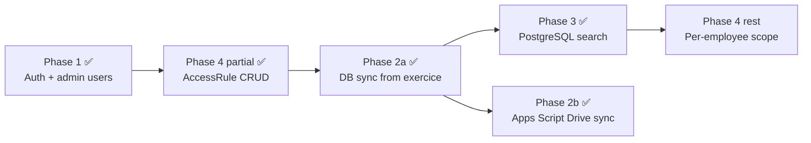

# Roadmap — current status

> **Strategy:** Prove the app end-to-end on `doc/debut` first, then swap the storage backend for Google Drive without changing UX or permission model. That swap is done — via Google Apps Script, not the Drive API (see below).

**Last updated:** 2026-07-14

---

## Product goal (unchanged)

**Admin manages RH portal accounts and controls which sous-dossiers each agent can view** — without giving every agent the full Drive root.

| Layer | Responsibility |
|-------|----------------|
| Google Drive | File storage (PDFs stay there) |
| Google Apps Script | Reads Drive + the Base sheet, pushes metadata to the portal (native services only — no Drive API, no service account held by the app) |
| PostgreSQL | Portal users, `AccessRule`, indexed file metadata |
| Next.js | Auth, permission enforcement, search UX, the one inbound signed webhook |

---

## Phase map



---

## Phase 2a — PostgreSQL index from exercise ✅ DONE

| Step | Deliverable | Status |
|------|-------------|--------|
| Prisma: `Employee`, `DriveFile`, `SyncLog` (+ `DocumentCategory`, `AccessRule`) | Schema | ✅ |
| `lib/storage/codification.ts` — parser + folder→category mapping | Parser module | ✅ |
| `lib/storage/localFolderProvider.ts` — scans `doc/debut/Dossiers Digitaux` | CLI-only dev/test provider | ✅ |
| `lib/sync/syncDriveIndex.ts` + `reconcileDriveIndex()` — upsert employees + files, remove stale | Core sync job (shared by local path and Apps Script webhook) | ✅ |
| `lib/import/parseExcelBase.ts` — employee metadata from Base sheet (exceljs) | Local/dev import | ✅ |
| `scripts/validate-sync.ts` — DB vs filesystem diff | Test script | ✅ 110 files, 0 diff |
| `GET /api/admin/sync` — read-only `SyncLog` overview for `/admin/sync` | Admin UI | ✅ |

**Verified:** `npm run sync:exercise` → 10 employees, 110 files; `npm run validate:sync` → 0 diff.

**Retired (2026-07-17):** the `POST /api/admin/sync` trigger, the "Synchroniser" button, and the admin-configurable schedule (`SyncSchedule` model + `lib/sync/scheduler.ts`) were removed once real Apps Script data became the target — they only ever operated on the local exercise fixture, and having them live in the same admin panel as the real synced data was actively dangerous (a click overwrote real data with the fixture, since both paths share the same tables and stale-removal is global, not per-source). `npm run sync:exercise` remains as a CLI-only dev tool.

---

## Phase 2b — Google Apps Script Drive sync ✅ DONE

IT ruled out the portal calling the Drive API directly (no OAuth client, no service account held by the app). Instead: a Google Apps Script — running under the company's own Workspace authorization, using only the built-in `DriveApp`/`SpreadsheetApp` services — reads the Drive folder tree and the Base sheet, then **pushes** the data to the portal over one authenticated, signed webhook. The portal never calls out to Google.

| Step | Deliverable | Status |
|------|-------------|--------|
| `POST /api/sync/apps-script` — HMAC-signed, replay-protected, rate-limited, strict-schema webhook | Route | ✅ |
| `lib/security/webhook-signature.ts` — HMAC-SHA256 + timestamp verification | Security | ✅ |
| `lib/validations/drive-sync.ts` — strict payload schema | Validation | ✅ |
| `scripts/apps-script/sync.gs` — reference script (chunked, signed, retries, overlap-guarded via `LockService`) | Reference implementation | ✅ |
| End-to-end test against a real personal Google account | Verification | ✅ real Drive folders → Apps Script → webhook → correct DB rows, including all 7 categories, filename-derived metadata, and the real exercise dataset (10 employees, 110 files) |
| `/admin/sync` as a read-only status/history view | Admin UI | ✅ — no trigger button; a real sync can only be started from Apps Script itself (manual run or its own time-driven trigger) |

See [APPS_SCRIPT_SYNC_SETUP.md](../../APPS_SCRIPT_SYNC_SETUP.md) for the setup steps, security model, and gotchas actually hit during testing (sheet-tab whitespace, UTF-8 signature charset, etc.), and [DEPLOYMENT.md](../../DEPLOYMENT.md) for the IT/production prerequisites.

**Known limits, not yet addressed:**
- Full re-scan every run, not incremental — fine at exercise scale, needs benchmarking against real headcount before full company rollout (Apps Script has a 6–30 min execution ceiling).
- Drive-level sharing and the portal's `AccessRule` are two independent permission systems — deliberately not auto-synced yet (see open question in [README.md](./README.md)).
- No audit trail yet for document views / permission changes / password resets.

---

## Phase 3 — Replace mock with database queries ✅ DONE

| UI | Change | Status |
|----|--------|--------|
| `/dashboard` | `GET /api/search/documents` → PostgreSQL + session `AccessRule` | ✅ |
| `/dashboard/employees` | `Employee` table (`listEmployees()`) | ✅ |
| `/dashboard/employees/[matricule]` | `DriveFile` rows with server-side access | ✅ |
| `/admin/sync` | Real `SyncLog` history, read-only status (no trigger button) | ✅ |
| Document open | `GET /api/documents/[id]/view` — authorized PDF streaming | ✅ |

`lib/mock/*` is retired from app code (kept only for `npm run test:exercise`).

---

## Phase 4 — Permission management (core product)

| Step | Status | Deliverable |
|------|--------|-------------|
| `AccessRule` CRUD API (`GET/PATCH /api/admin/permissions`) | ✅ | |
| Permissions matrix persists to DB, real portal users | ✅ | |
| Default rules by role on user create | ✅ | |
| Per-employee scope (`employeeId` on rule) | ⏳ | Not started |
| Drive-level permission alignment | ⏳ | Deliberately deferred — see README open questions |

---

## Re-indexing after data changes

Local/dev path:

```bash
npm run sync:exercise      # re-index local doc/debut into PostgreSQL
npm run validate:sync      # must report 0 diff
```

Apps Script path: run `runSync` (or `testRunSyncManually`) from the Apps Script editor, or wait for its time-driven trigger. **Don't run both against the same data in one session** — whichever runs last wins (see the note in [README.md](./README.md)).

---

## Files to @-mention when coding

```
@doc/TECHNICAL.md
@doc/APPS_SCRIPT_SYNC_SETUP.md
@doc/debut/exercice/ROADMAP.md
@doc/debut/exercice/CODIFICATION.md
@lib/document-category.ts
@lib/permissions/access-rules.ts
@lib/sync/syncDriveIndex.ts
```

---

## See also

- [OVERVIEW.md](./OVERVIEW.md) — data model
- [DRIVE-STRUCTURE.md](./DRIVE-STRUCTURE.md) — folder tree
- [EXCEL-SHEETS.md](./EXCEL-SHEETS.md) — Base/Arborescence/Codification columns
